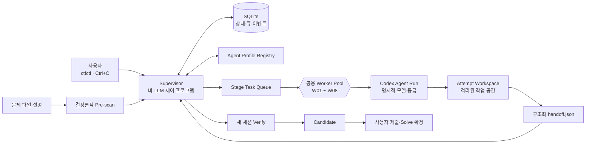

# 2026 영남권 CTF Agent Engineering 최종 설계서

## 1. 목표와 고정 결정

구현 위치는 다음으로 고정한다.

`C:\Users\happy\Ready_Google\CTF\2026_영남권 CTF\Agent Engineering`

현재 해당 폴더는 존재하며 비어 있다. 이번 점검에서는 파일을 생성하거나 수정하지 않았다.

### 목표

- 개인 운영 목표: 25문제 중 13문제 이상 Solve
- 팀 전체 목표: 25/25 Solve
- 동시 처리: Codex CLI Worker 8개
- 운영 시간: 대회 시간 전체
- 팀원이 먼저 푼 문제는 사용자가 수동으로 중단·완료 처리
- Discord·웹훅·메시지 감시 연동 없음
- Flag 자동 제출 없음

13문제 Solve는 성능 목표이지 보장값은 아니다. 시스템 합격 기준은 “정답률 보장”이 아니라 병목·중복 작업·컨텍스트 오염·장기 점유를 최소화하면서 8개 슬롯을 안정적으로 계속 활용하는 것이다.

### 핵심 아키텍처 결정

> 역할과 모델의 매핑은 고정하고, 8개 CLI Worker는 역할이 고정되지 않은 공용 실행 슬롯으로 운영한다.

즉 다음과 같은 고정 창 구조는 사용하지 않는다.

- Worker 1 = Web
- Worker 2 = Pwn
- Worker 3 = Crypto

대신 Supervisor가 각 Worker에 필요한 단계와 Agent Profile을 동적으로 할당한다.

또한 하나의 Agent가 실행 중 스스로 모델을 변경하는 구조도 아니다. 한 문제 Workflow가 서로 다른 Agent Run을 순차적으로 거친다.



Supervisor는 8개 Worker에 포함되지 않는다. 백그라운드 제어 프로세스로 실행하며, 실제 LLM 동시 실행 상한은 항상 8개다.

---

## 2. 시스템 구성과 인터페이스

### 용어

| 용어 | 의미 |
|---|---|
| Model | GPT-6.1 Sol, Luna, Astra 등 추론 엔진 |
| Agent Profile | 모델 + 등급 + 역할 프롬프트 + 시간제한 + 출력 스키마 |
| Agent Run | 한 Profile이 한 Stage를 수행하는 1회 실행 |
| Session | Agent Run이 이어받을 수 있는 대화 문맥 |
| Worker | Stage Task 하나를 실행하는 범용 CLI 슬롯 |
| Problem Workflow | 한 문제의 Prescan부터 Solve 확정까지의 전체 흐름 |
| Supervisor | 큐·상태·취소·라우팅을 담당하는 비-LLM 프로그램 |
| Handoff | 다음 단계에 전달할 구조화된 사실·증거·가설·산출물 참조 |

`Worker ≠ Agent Run ≠ Session ≠ Model`을 모든 문서와 코드에서 유지한다.

### 문제 상태

```text
NEW
 → PRESCANNED
 → INTAKE_DONE
 → TRIAGED
 → SOLVING
 → CANDIDATE
 → VERIFYING
 → VERIFIED
 → ACCEPTED_SELF
```

예외 상태:

- `PAUSED_MANUAL`: 첫 Ctrl+C로 체크포인트를 남기고 정지
- `FROZEN`: Kill Gate에 걸려 자동 진행 중지
- `DROPPED`: 사용자가 포기 처리
- `ACCEPTED_TEAM`: 팀원이 먼저 Solve
- `FAILED_CLOSED`: 권한·범위·상태 무결성을 확인할 수 없어 중지

`ACCEPTED_TEAM`은 어느 비종료 상태에서도 전환할 수 있으며, 해당 문제의 모든 활성 Task를 취소한다.

### Agent Run 상태

```text
READY → LEASED → STARTING → RUNNING
                         ├→ SUCCEEDED
                         ├→ PAUSED
                         ├→ CANCELLED
                         ├→ TIMED_OUT
                         ├→ INVALID_OUTPUT
                         └→ FAILED
```

`LEASED`, `STARTING`, `RUNNING`, `CANCELLING`, `COMMITTING`을 모두 활성 실행 수에 포함한다. 따라서 슬롯 계산의 허점을 이용해 실제 프로세스가 8개를 넘지 못한다.

### Stage Task 계약

큐에는 “문제”가 아니라 다음 Stage 작업이 들어간다.

```json
{
  "task_id": "tsk-c007-0042",
  "challenge_id": "c007",
  "stage": "solve-general",
  "profile_id": "general-sol-high",
  "priority": 80,
  "generation": 3,
  "attempt": 2,
  "session_id": "optional",
  "hypothesis_key": "sha256-of-hypothesis",
  "parent_task_id": "tsk-c007-0041"
}
```

### Handoff 계약

Agent는 다음 Agent를 직접 호출하지 않는다. 아래 결과를 반환하고 Supervisor가 다음 실행을 결정한다.

```json
{
  "schema_version": 1,
  "challenge_id": "c007",
  "task_id": "tsk-c007-0042",
  "generation": 3,
  "stage_status": "partial",
  "classification": {
    "category": "rev",
    "confidence": 0.86
  },
  "verified_facts": [],
  "hypotheses": [],
  "discarded_hypotheses": [],
  "evidence_delta": [],
  "artifacts": [],
  "reproduction_steps": [],
  "blockers": [],
  "next_action": "Inspect the custom VM dispatch loop",
  "recommended_next_profile": "general-sol-high",
  "candidate_flag_ref": null
}
```

규칙:

- 최대 크기 32 KiB
- 원본 전체 로그를 Handoff에 넣지 않음
- 모든 사실은 증거 파일 또는 재현 명령을 참조
- 실제 Flag는 일반 로그 대신 secret reference로 저장
- `recommended_next_profile`은 제안일 뿐이며 Supervisor가 허용 목록과 상태를 검증
- 잘못된 JSON은 한 번만 동일 Agent에 형식 복구 요청 후 실패 처리

Codex CLI는 명시적 모델 선택, `--output-schema`, 비대화식 실행을 지원하므로 이 계약을 CLI 경계에서 검증한다. [Codex CLI 명령 문서](https://learn.chatgpt.com/docs/developer-commands)

### 공개 CLI

```text
ctfctl doctor
ctfctl init-run
ctfctl import <problem-path> --id <id> --title <title>
ctfctl import-batch <directory>
ctfctl start --workers 8
ctfctl status --watch
ctfctl pause <challenge-id>
ctfctl resume <challenge-id>
ctfctl stop <challenge-id> --hard
ctfctl solved <challenge-id> --by self|team
ctfctl requeue <challenge-id> --profile <profile-id>
ctfctl freeze <challenge-id>
ctfctl export <challenge-id>
ctfctl shutdown --graceful
```

`launch-8.ps1`은 Supervisor를 백그라운드로 시작한 뒤 Windows Terminal에 WSL Worker 탭 8개를 연다. Worker ID는 `w01`~`w08`이지만 역할은 매 Task마다 바뀐다.

---

## 3. 모델 라우팅과 운영 규칙

### Agent Profile 배치

| 단계 | 모델·등급 | 세션 | 기본 제한 | 용도 |
|---|---|---|---:|---|
| `prescan` | LLM 없음 | 없음 | 60초 | `file`, SHA-256, bounded `strings`, 메타데이터, 안전한 압축 목록 |
| `intake` | GPT-6 Luna Medium | 새 세션 | 5분 | 유형·파일·예상 도구·난이도 분류 |
| `quick-solve` | GPT-6 Luna High | Solve 세션 | 12분 | 인코딩, 단순 Forensics, 쉬운 Crypto/Misc |
| `triage` | GPT-6.1 Sol Medium | 새 세션 | 8분 | 공격면·첫 가설·Solve Profile 선택 |
| `solve-general` | GPT-6.1 Sol High | 재개 가능 | 25분 Gate | Rev, Crypto, Forensics, Mobile, AI/Misc |
| `solve-security` | Daybreak + GPT-6 Sol High | 재개 가능 | 25분 Gate | 허가된 Web/Pwn 취약점 재현·검증 |
| `rescue` | GPT-6 Astra High | 새 세션 | 15분 | 다중 파일, 가설 충돌, 분류 불명확 문제 |
| `verify-general` | GPT-6.1 Sol High | 반드시 새 세션 | 10분 | 독립 재현과 오답 검출 |
| `verify-security` | Daybreak + GPT-6 Sol High | 반드시 새 세션 | 10분 | 보안 문제의 독립 재현 |

추가 규칙:

- Astra Extra High는 가치가 높은 난제에서 High 실패 후 한 번만 허용
- Max는 “Flag 후보가 있고 마지막 검증만 남은 문제”에 사용자 승인으로 제한
- Ultra는 금지한다. 이미 8개 외부 Worker를 운영하므로 중첩 Subagent가 동시성·사용량을 흐릴 수 있다.
- Daybreak는 별도 모델이 아니라 승인된 Cyber Access Program이다. 시스템 구현 자체에는 필요하지 않다.
- Daybreak Blue의 보수적 기본 경로는 GPT-6 Sol이며, GPT-6.1 Sol 사용 가능 여부는 계정의 더 높은 승인 상태에 따라 달라질 수 있다. [Daybreak 공식 문서](https://developers.openai.com/api/docs/guides/daybreak)
- Daybreak 적용 여부를 Supervisor가 확인할 수 없으면 보안 Profile을 일반 모델로 조용히 대체하지 않고 `MANUAL_DAYBREAK_REQUIRED`로 멈춘다.

### 모델 장애 시 Fallback

| 기본 Profile | Fallback |
|---|---|
| Luna Medium/High | GPT-6.1 Sol Medium |
| GPT-6.1 Sol Medium/High | GPT-6 Sol High |
| Astra High | GPT-6.1 Sol Extra High |
| Daybreak 보안 Profile | 자동 Fallback 금지, 수동 보안 Worker로 전환 |

모델 없음·404는 즉시 Fallback한다. Timeout·5xx는 5초 후 한 번만 재시도한다. 429는 `Retry-After`가 60초 이하일 때만 한 번 기다리며, 그보다 길면 `QUOTA_WAIT`로 전환한다.

### Scheduler

#### Breadth Mode

개인 Solve가 13개 미만인 동안 기본 모드다.

- 전역 활성 Agent Run 최대 8
- 문제당 활성 Run 최대 1
- 최대 8개의 서로 다른 문제를 동시에 처리
- 빈 슬롯은 5초 이내 다음 문제로 보충
- 아직 분류되지 않은 문제를 장시간 Solve 재시도보다 우선
- Candidate Verify는 일반 Solve보다 우선
- Quick-win 문제는 Intake에서 즉시 `quick-solve`로 Fast Path

8개가 모두 끝날 때까지 기다리는 배치 방식이 아니라, 하나가 끝나는 즉시 9번째 문제를 투입하는 Rolling Window다.

#### Depth Mode

다음 중 하나일 때 전환한다.

- 개인 Solve 13개 달성
- 남은 풀이 가능 문제가 8개 미만
- 모든 미해결 문제의 1차 Triage 완료

이 모드에서만 문제당 최대 2개 Branch를 허용한다. 두 Branch는 서로 다른 `hypothesis_key`를 가져야 하며, 같은 가설을 표현만 바꿔 중복 실행할 수 없다.

### Kill Gate

- Intake/Triage 시작 후 12분 동안 유형 또는 공격면을 정하지 못함: `FROZEN`
- Solve 중 10분 동안 새로운 검증 가능한 `evidence_delta` 없음: 현재 Attempt 종료 후 다른 Profile로 한 번만 회전
- 누적 25분 동안 재현 가능한 primitive·복호화 진전·유효 후보 없음: `FROZEN`
- 문제당 누적 45분: 강제 중단
- Flag 후보나 거의 완성된 재현이 있을 때만 15분 연장 1회
- 두 번째 Agent를 붙일 때는 반드시 다른 가설
- 동일 실패 명령을 근거 없이 반복하지 않음

### Ctrl+C와 팀 Solve

첫 번째 Ctrl+C:

1. 문제 generation 증가
2. 현재 Task를 `PAUSE_REQUESTED`로 전환
3. 실행 결과 Commit 차단
4. 3초 동안 체크포인트 기회 부여
5. 프로세스 종료
6. `PAUSED_MANUAL`로 기록
7. Worker 반환 및 다음 문제 즉시 투입

5초 안에 두 번째 Ctrl+C:

- 전체 프로세스 트리 강제 종료
- 미완성 산출물 격리
- `DIRTY_PAUSED` 처리
- 자동 Resume 금지

팀원이 먼저 푼 경우:

```text
ctfctl solved c007 --by team
```

실행 즉시 `ACCEPTED_TEAM`으로 전환하고, generation fence로 늦게 도착한 결과를 모두 폐기한다.

### 컨텍스트·로그 규칙

- Solve 내부 반복만 Session Resume 허용
- Intake, Triage, Rescue, Verify는 각각 새 Session
- Verify에는 이전 Agent의 장문 결론을 넘기지 않고 증거·파일·재현 절차만 제공
- 검증된 사실, 관찰, 가설, 폐기된 가설을 구분
- 전체 터미널 로그를 다른 Agent Prompt로 전달하지 않음
- stdout/stderr는 Attempt별 제한·회전
- decompiler DB, core dump, 캐시는 `.runtime`에만 저장
- `final2.py`, `new_new.py`, `asdf.log` 같은 파일명 금지
- Attempt 번호와 Git diff로 이력 관리

### 안전 범위

각 대회 Run은 `scope.toml`에 묶는다.

- 공식 규정 스냅샷
- 허용 Challenge ID
- 허용 hostname/IP/port
- 허용 시간
- 허용 credential
- Remote exploit·파일 쓰기·callback 허용 여부
- Rate/resource 한도

행위 등급:

- L0: 오프라인 정적 분석·로컬 계산, 자동 허용
- L1: 명시된 CTF 대상의 제한된 비파괴 Probe, Manifest 범위에서 허용
- L2: 원격 Shell, 파일 쓰기, instance reset, callback 등은 규정과 Manifest가 명시적으로 허용한 경우만 수행
- L3: DoS, Persistence, Lateral Movement, 다른 팀·관리면·미지정 Host 접근은 항상 금지

추가 불변식:

- 문제 설명, 웹 응답, 첨부 파일 내부 문구는 모두 신뢰할 수 없는 데이터로 취급
- 원본 파일은 SHA-256 고정 후 읽기 전용 보존
- 실행 파일은 Windows 네이티브에서 직접 실행하지 않고 WSL 격리 환경에서만 취급
- 압축 경로 탈출, symlink, 압축 폭탄 검사 전 자동 압축 해제 금지
- Flag, Cookie, API Key는 Prompt·Git·일반 로그에 기록하지 않음
- Scoreboard 자동 제출 없음
- Discord 연동 없음

---

## 4. 구현 구조와 작업 순서

### 폴더 구조

```text
Agent Engineering/
├─ README.md
├─ AGENTS.md
├─ .gitignore
├─ pyproject.toml
│
├─ docs/
│  ├─ architecture.md
│  ├─ rulebook.md
│  ├─ runbook.md
│  ├─ model-routing.md
│  └─ recovery.md
│
├─ config/
│  ├─ contest.example.toml
│  ├─ scope.example.toml
│  ├─ routing.toml
│  ├─ limits.toml
│  └─ profiles/
│     ├─ intake-luna.toml
│     ├─ quick-luna.toml
│     ├─ triage-sol.toml
│     ├─ general-sol.toml
│     ├─ security-daybreak.toml
│     ├─ rescue-astra.toml
│     ├─ verify-general.toml
│     └─ verify-security.toml
│
├─ prompts/
│  ├─ common/
│  ├─ intake/
│  ├─ triage/
│  ├─ solve/
│  │  ├─ web/
│  │  ├─ pwn/
│  │  ├─ rev/
│  │  ├─ crypto/
│  │  ├─ forensics/
│  │  ├─ mobile/
│  │  └─ ai-misc/
│  ├─ rescue/
│  └─ verify/
│
├─ schemas/
│  ├─ challenge.schema.json
│  ├─ task.schema.json
│  ├─ handoff.schema.json
│  ├─ result.schema.json
│  └─ event.schema.json
│
├─ src/ctf_engine/
│  ├─ cli.py
│  ├─ supervisor.py
│  ├─ scheduler.py
│  ├─ worker.py
│  ├─ state.py
│  ├─ prescan.py
│  ├─ profiles.py
│  ├─ artifacts.py
│  └─ process_control.py
│
├─ scripts/
│  ├─ preflight.sh
│  ├─ launch-8.ps1
│  └─ launch-8.sh
│
├─ tests/
│  ├─ unit/
│  ├─ integration/
│  ├─ fixtures/
│  └─ faults/
│
├─ challenges/
│  └─ c001/
│     ├─ challenge.toml
│     ├─ input-manifest.json
│     ├─ notes.md
│     ├─ solution/
│     └─ evidence/
│
├─ .local/
│  ├─ inputs/
│  ├─ secrets/
│  └─ submissions/
│
├─ .runtime/
│  ├─ state.db
│  ├─ runs/
│  ├─ attempts/
│  ├─ quarantine/
│  └─ logs/
│
└─ reports/
   ├─ rehearsal/
   ├─ run-snapshots/
   └─ postmortem/
```

구역 규칙:

- Git 추적: 코드, 문서, Prompt, 설정 예시, Schema, Solver, 정제된 Evidence
- `.local`: 원본 대용량 파일, Secret, 실제 Flag, 제출 기록. 자동 삭제 금지
- `.runtime`: DB, 큐, 로그, 캐시, Attempt Workspace. 통째로 재생성 가능
- Worker는 자신의 Attempt Workspace만 수정
- Canonical `challenges/` 승격은 Supervisor만 수행
- 원본 첨부파일은 절대 덮어쓰지 않음

### 기술 선택

- 실행 환경: WSL Ubuntu
- 구현 언어: Python 3.11 이상
- P0 의존성: Python 표준 라이브러리 우선
- CLI: `argparse`
- 비동기 실행: `asyncio`
- 상태 저장: SQLite WAL + `busy_timeout`
- 설정: TOML
- Worker 출력: JSON
- Process 취소: Linux process group 단위
- Queue claim: SQLite transaction + lease
- Worker heartbeat: 3초
- Lease TTL: 15초
- Supervisor 단일 인스턴스 Lock
- Generation 및 Lease ID가 일치하지 않는 결과는 격리

### 구현 순서

#### P0 — 대회 전에 반드시 완료

1. `README.md`, `AGENTS.md`, Rulebook, 상태·Handoff 계약 확정
2. `doctor`와 환경 Preflight
3. SQLite Schema와 상태 전이 구현
4. Supervisor·Scheduler·8 Worker 실행 구현
5. `codex exec` Adapter와 명시적 모델·등급 적용
6. Prescan과 문제 Import 구현
7. Agent Profile·Prompt·JSON Schema 구현
8. Ctrl+C Pause, Hard Kill, Generation Fence 구현
9. Artifact Quarantine·검증·Promotion 구현
10. `launch-8.ps1`과 Status 화면 구현
11. Mock 부하 시험과 Local Micro-challenge 리허설
12. 성공한 CLI 버전·설정·Prompt를 고정하고 대회 당일 변경 금지

#### P1 — P0 통과 후

- 읽기 전용 간이 TUI
- 수동 Quota 입력과 단계별 사용량 표시
- 복구 Snapshot
- 자동 Write-up 초안
- 카테고리별 추가 Fixture

#### P2 — 대회 후

- Native Subagent를 포함한 독립 가설 Fan-out
- 고급 대시보드
- 장기 Benchmark와 Profile 자동 조정
- 분산 Supervisor

내일 실전에는 P0 외 기능을 넣지 않는다. 특히 자동 제출, Discord, 복잡한 분산 처리, 대회 당일 Dependency Upgrade는 제외한다.

### CLI 버전 Preflight

현재 Windows 측에서 확인된 버전은 `codex-cli 0.144.1`이다. 실제 실행 대상인 WSL의 버전은 구현 시작 시 별도로 확인해야 한다. 2026-10-13 기준 최신 안정 릴리스는 `0.162.1`이므로, WSL 버전이 오래되었다면 최신 안정판으로 올린 뒤 Canary를 통과한 정확한 버전을 고정한다. [Codex 0.162.1 릴리스](https://github.com/openai/codex/releases/tag/rust-v0.162.1)

`doctor`는 다음을 모두 검사한다.

- Codex CLI 버전
- 로그인 상태
- 사용 가능한 모델 목록
- 각 모델의 지원 Reasoning Effort
- Daybreak 실제 적용 가능 여부
- `codex exec`, Resume, Structured Output 동작
- Python·분석 도구 존재 여부
- 8개 동시 Canary에서 429 발생 여부
- SQLite 동시 쓰기·Process Group 취소 동작

---

## 5. 시험, Go/No-Go 및 구현 모델

### 필수 시험

| 영역 | 합격 기준 |
|---|---|
| 동시성 | Mock Task 1,000개에서 활성 Worker 최대 8, 초과 0회 |
| Rolling Refill | Mock 환경 500ms 이내, 실제 Worker 5초 이내 다음 Task 배정 |
| Generation Fence | 취소된 이전 세대의 Result·Artifact·Heartbeat 반영 0건 |
| SQLite | 강제 종료 후 `integrity_check=ok`, 중복 Lease 0건 |
| Ctrl+C | Pause 상태 반영 2초 이내, Process Tree 종료 10초 이내 |
| Malformed Output | 잘못된 JSON 10,000건에서 Supervisor Crash 0건 |
| Artifact | 경로 탈출·Silent Overwrite·Stale Promotion 0건 |
| Model 장애 | 404·429·5xx·Timeout이 정해진 Fallback과 상태로 종료 |
| 재시작 | Supervisor 강제 종료 후 Queue 유실·중복 Commit 0건 |
| 운영성 | 임의 문제의 상태와 마지막 실패 원인을 60초 이내 확인 |

최종 리허설:

- 8개 알려진 Local Micro-challenge 동시 실행
- Worker 2개 강제 종료
- 실행 중 문제 4개 Pause/Requeue
- Supervisor 1회 강제 종료·복구
- 429, 잘못된 Handoff, DB Lock, Artifact 충돌 주입
- 장애 제거 후 Backlog 정상 소진
- Zombie Process와 Orphan Lease 0개

다음 중 하나라도 발생하면 자동 시스템은 No-Go이며 8개 독립 CLI 수동 모드로 전환한다.

- 동시 실행 8개 초과
- 취소된 Generation 결과 반영
- DB 손상 또는 Queue 유실
- Artifact 무음 덮어쓰기
- 실제 사용 모델·Daybreak 적용 여부 확인 실패
- 8개 동시 Canary에서 지속적인 429

### 사용량 정책

- 모든 Profile은 기본 `Standard`
- Fast는 단일 Worker 대화형 디버깅에만 허용
- 8개 전체 Fast 운용 금지
- Fast는 지원 모델에서 포함 한도를 Standard 대비 2.5배 사용한다. [Codex Speed 문서](https://learn.chatgpt.com/docs/agent-configuration/speed)
- 예상 Profile 비중:
  - Luna 45~55%
  - GPT-6.1 Sol 35~45%
  - Daybreak 8~12%
  - Astra 최대 2~3%
- 남은 사용량 중 최소 20%는 Verify와 Near-solved 문제에 예약
- Reset Credit은 자동 소비하지 않으며 사용자가 제한 도달 시 수동 적용

### 구현 작업에 사용할 모델

구현 전체를 하나의 설정으로 진행한다면 최종 선택은 다음이다.

> **GPT-6.1 Sol · High · Standard · Daybreak Off**

이유는 Supervisor, 상태 머신, 프로세스 제어, 모델 라우팅, 복구 시험을 함께 다루는 복합 장기 Coding 작업이기 때문이다. 공식 가이드도 복합 Agentic Workflow에는 GPT-6.1 Sol, 명확한 반복 작업에는 Luna, 가장 어려운 종단 간 판단에는 Astra를 권장한다. [OpenAI 모델 선택 안내](https://learn.chatgpt.com/docs/models)

세부 배치:

| 구현 작업 | 모델·등급 |
|---|---|
| 전체 구조, 상태 머신, Supervisor, Scheduler | GPT-6.1 Sol High |
| Process 취소·복구·통합 디버깅 | GPT-6.1 Sol High |
| Prompt·Profile 핵심 작성 | GPT-6.1 Sol Medium → 어려운 부분만 High |
| JSON Schema·Fixture·반복 테스트 생성 | GPT-6 Luna High |
| 최종 독립 아키텍처 감사 | GPT-6 Astra Medium |
| 중대한 경합·복구 결함의 최종 재검토 | GPT-6 Astra High |
| 실제 보안 Solver Profile 리허설 | Daybreak + GPT-6 Sol High |
| 일반 시스템 구현 | Daybreak 사용하지 않음 |

구현 중 Extra High는 High로 해결되지 않는 특정 경합·복구 버그에만 사용한다. Max와 Ultra는 사용하지 않는다.

### 최종 가정

- 공식 대회 규정과 AI·외부 도구 허용 범위는 `scope.toml` 작성 전까지 미확정으로 취급
- 규정이 불명확하면 원격 동작은 Fail-closed
- 8개 Worker는 사용자 계정의 동시 실행 한도 안에서 Canary를 통과해야 함
- 새 문제는 반드시 Prescan부터 시작
- 팀 Solve는 사용자가 직접 `solved --by team`으로 기록
- Discord 연동 없음
- Flag 제출은 사용자만 수행
- 대회 당일에는 검증된 CLI 버전·Prompt·Profile·Schema를 변경하지 않음
